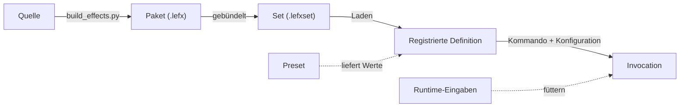

# 04 — Begriffe und Systemobjekte

LEFX verwendet präzise Begriffe, weil das einzelne Wort `Effekt` fünf
verschiedene Dinge meinen kann: eine Quelle, ein Paket, eine Definition, ein
Preset oder eine laufende Ausführung. Wer sie nicht trennt, kann nicht sagen,
was gerade schiefgegangen ist.

## Objektkette



Links davon steht, was jemand geschrieben hat. Rechts davon, was gerade
leuchtet. Die Grenze verläuft beim Laden.

## Quelle

Das bearbeitbare Verzeichnis, aus dem ein Paket gebaut wird. Es enthält:

- `effect.yaml` — die Definition
- `effect.py` — die Renderlogik
- optional `presets.yaml`

Im Arbeitsbaum liegen die Quellen unter
`effects/<set>/sources/<typ>/<name>/`. Eine Quelle ist weder das ausgelieferte
Paket noch etwas, das läuft.

## Paket

Ein gebautes `.lefx`-Archiv mit **genau einer** Definition. Es trägt Definition,
Renderlogik, Metadaten und optionale Presets.

Ein Paket ist die Auslieferungseinheit. Es hat keine Kenntnis davon, in welchem
Set es landet oder auf welcher Hardware es je gerendert wird.

## Set

Ein `.lefxset`-Archiv, das mehrere Pakete zu einem Katalog bündelt — abgestimmt
auf einen Anwendungsfall, nicht auf ein Gerät. `core-set` trägt die
allgemeinen Muster, `smartspeaker-set` die eines Sprachassistenten.

Welche Sets geladen werden, ist eine Laufzeitfrage (`included_lefxset`), keine
Installationsfrage. Ein installiertes Set, das nicht geladen wird, ist so gut
wie nicht da.

## Definition

Beschreibt einen State, ein Overlay oder ein Event. Sie legt Möglichkeiten und
Grenzen fest und besitzt **keinen** aktiven Zustand:

- Typ und, bei Overlays, den Modus (`controlled` oder `timed`)
- Parameterschema mit Vorgaben und Grenzen
- Runtime-Input-Schema, falls die Form eines hat
- Layer- und Lebenszyklusregeln
- Farbmodell

Die Definition ist unveränderlich. Mehrere zeitlich getrennte Aktivierungen
teilen sich dieselbe Definition, ohne einander zu beeinflussen.

## Preset

Ein benannter Konfigurationsvorschlag für **genau eine** Definition. Ein
bequemer Startpunkt, keine Begrenzung: Was ein Preset setzt, lässt sich
weiterhin frei überschreiben.

Ein Preset darf weder Typ noch Layer noch Lebensdauer ändern. Es liefert Werte,
sonst nichts. Effekt- und Presetnamen liegen im selben Namensraum — wer
`listening_calm_cyan` sagt, meint dieselbe Definition wie `listening`, nur mit
anderen Werten.

## Konfiguration

Die Werte, mit denen eine Definition aufgerufen wird. Sie werden gegen das
Parameterschema geprüft, normalisiert und in der Invocation festgehalten.

Nicht zu verwechseln mit `config.yaml`, das den *Dienst* konfiguriert —
Bildrate, Sink, Suchpfade. Das eine beschreibt, wie ein Effekt aussieht, das
andere, wo er hinausgeht.

## Runtime-Eingabe

Fortlaufende Werte, die eine laufende Instanz füttern: ein Fortschritt zwischen
0 und 1, ein Richtungswinkel, ein Pegel. Nur Controlled Overlays haben sie.

Eine Runtime-Eingabe ist keine Konfiguration. Konfiguration wird beim Aufruf
einmal festgelegt; Runtime-Eingaben ändern sich, während die Instanz läuft.

## Invocation

Eine laufende Ausführung: Definition, aufgelöste Werte, Layer, und wo sie in
ihrem Lebenszyklus steht. Sie trägt unter anderem `invocation_id`, `params`,
`inputs`, `created_at`, `activated_at`, `duration_ms`, `priority`, `channel`
und `preset_id`.

`created_at` und `activated_at` sind zweierlei: Ein Event, das in der
Warteschlange steht, ist angenommen, aber noch nicht sichtbar.

## Slot

Einer von zwei Plätzen, die ein State einnehmen kann: `background` oder
`primary`. Der Hintergrund liegt unter dem Vordergrund und überlebt einen
Neustart, sofern die Definition sich als wiederherstellbar ausweist.

Ein Slot fasst genau einen State. Ein zweiter ersetzt den ersten — es gibt
keine Warteschlange für Zustände.

## Channel

Der Name, unter dem ein Controlled Overlay läuft und angesprochen wird. Zwei
Overlays auf verschiedenen Kanälen laufen nebeneinander; ein zweites auf
demselben Kanal ersetzt das erste.

Der Kanal ist die Adresse für spätere `update`- und `clear`-Aufrufe. Ohne ihn
gäbe es keine Möglichkeit, eine von mehreren laufenden Anzeigen zu meinen.

## Layer

Die Kompositionsstufe, auf der eine Invocation liegt. Fünf, von unten nach
oben:

| Layer | Priorität |
|---|---|
| `background_state` | 100 |
| `primary_state` | 200 |
| `timed_overlay` | 400 |
| `controlled_overlay` | 500 |
| `event` | 600 |

**Der Layer wird nicht gewählt, sondern folgt aus der Form.** Ein State im
Primary-Slot liegt auf `primary_state`, ein Event auf `event`. Das ist der
Grund, warum eine Meldung nie hinter einer Anzeige verschwindet.

Controlled Overlays liegen bewusst über zeitgesteuerten: Eine laufende
Messanzeige soll sichtbar bleiben, und was wirklich alles verdecken muss, ist
ein Event.

## IDs

- **Effekt-ID** — der Name einer Definition, eindeutig innerhalb ihrer Quelle
- **Preset-ID** — der Name eines Presets, im selben Namensraum
- **`quelle::id`** — die qualifizierte Form, nötig wenn zwei geladene Sets
  denselben Namen tragen
- **Invocation-ID** — identifiziert eine laufende Ausführung, nicht die
  Definition dahinter

## Sprachregel

`Effektsystem` und `Effektentwicklung` bleiben eindeutige Oberbegriffe. In
technischen Aussagen wird benannt, was gemeint ist.

```text
Ungenau:  Der Effekt wird aktualisiert.
Präzise:  Die Runtime-Eingaben der Invocation auf Kanal "volume" werden
          aktualisiert.

Ungenau:  Der Effekt ist kaputt.
Präzise:  Das Paket lässt sich nicht laden, weil ein Import fehlt.
          — oder —
          Die Definition lädt, aber die Konfiguration verletzt das
          Parameterschema.
```

Die beiden letzten Fälle sehen im Betrieb gleich aus und haben nichts
miteinander zu tun. Genau dafür lohnt sich die Unterscheidung.

## Kernsätze

- Fünf Dinge heißen umgangssprachlich „Effekt"; im technischen Satz wird
  gesagt, welches gemeint ist.
- Die Definition beschreibt, die Invocation läuft. Die Definition ändert sich
  dabei nie.
- Konfiguration wird einmal gesetzt, Runtime-Eingaben laufen mit.
- Der Layer folgt aus der Form. Er wird nie gewählt.
